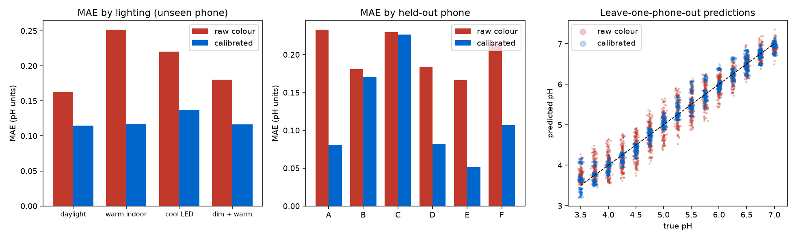

# pHera demo: colorimetric pH from smartphone photos (synthetic data)

A small, end-to-end prototype of the pipeline described in the pHera role. **Everything is simulated**: the pH-to-colour curve is a made-up yellow-green-blue indicator and the phones are random colour/tone/noise models. It shows how I would structure the problem, not how accurate a real strip would be.

## What it does
| Stage | Module | Idea |
|---|---|---|
| Phones and lighting | `camera.py` | 6 phones (own colour matrix, gamma, auto-white-balance, noise, blur) x 4 lighting conditions (warm, cool, dim, shading gradients) |
| Colour calibration | `calibrate.py` | 8 printed reference patches, each twice (point-symmetric, so linear shading cancels). Per-channel tone curve from the grey ramp, then a ridge-regularised 3x3 colour matrix |
| pH model | `model.py` | Ridge on polynomial Lab features, output rounded to 0.25 pH steps |
| Uncertainty | `model.py` | Split-conformal 90% interval, calibrated on leave-one-phone-out residuals |
| Personalisation | `baseline.py` | Bayesian local-level (Kalman) model with a population prior; two consecutive same-direction outliers flag a change |
| Evaluation | `evaluate.py` | Leave-one-phone-out, so every number is on a phone the model has not seen |
| Demo | `app.py` | Gradio app (phones E and F are never used for training) |

## Run
```bash
uv sync
uv run pytest
uv run python -m phera.evaluate --n 3000   # writes results/
uv run python -m phera.app                 # Gradio, share=True
```

## Results (3000 simulated photos, leave-one-phone-out)
| pipeline | MAE (pH) | 90th pct error | within 0.25 pH | exact 0.25 step |
|---|---|---|---|---|
| raw colour | 0.203 | 0.425 | 67.7% | 37.9% |
| calibrated | 0.121 | 0.283 | 86.0% | 65.7% |

Conformal 90% interval on two completely unseen phones: half-width +/-0.38 pH, empirical coverage 100% (conservative; only two test phones).



## Honest limitations
- **Synthetic only.** No real strips, no real photos. The first real task would be collecting a strip/phone/lighting dataset with lab reference pH.
- **Calibration does not help every phone.** Phones B and C improve little (see middle plot). The simple tone-curve + 3x3 model cannot undo every device's colour pipeline; this is where learned correction or more patches would be explored.
- **Fixed chart layout.** The card is located by nominal position with small shift jitter. A real app needs fiducial detection, perspective correction, glare and blur rejection, and a quality gate that asks for a retake.
- **No LLM/RAG explanation layer** in this demo.
- The baseline model uses a fixed measurement noise; a real system would learn the hierarchy (population and per-user parameters) from data, e.g. with PyMC/Stan.
- Not a medical device; no clinical claims.
